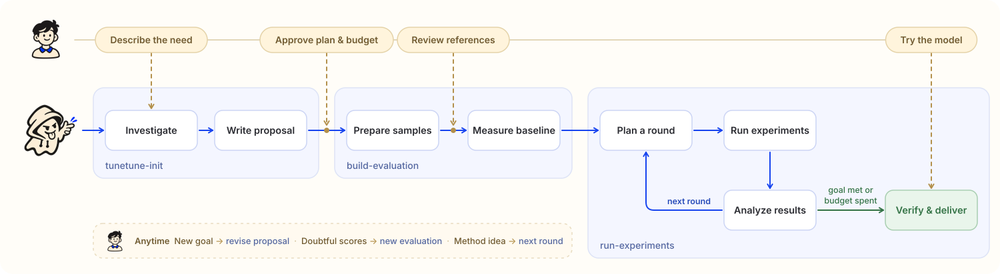

<p align="center">English · <a href="README_zh.md">简体中文</a></p>


> A human–agent research workbench for training, evaluating, and iterating on small models for specific tasks.

[](https://github.com/nanshine/tunetune/actions/workflows/ci.yml) [](https://www.npmjs.com/package/dsh-tunetune) [](LICENSE)

## Quick start

Send this to your Agent:

```text
Install TuneTune following https://github.com/nanshine/tunetune/blob/main/INSTALL.md
```

Then, in the folder where you want to start a study, try a request like:

```text
Use TuneTune to train a small model that recognizes Donald Trump in photos, using public data.
```

Already installed? Start with the request. Prefer to install it yourself? See [Installation](#installation).

<!-- Add a real demo video here once recorded, using the same request and showing actual elapsed time. -->

## How it works

Describe what you want the model to do. Your Agent investigates methods, asks the questions that matter, and proposes a direction and resource budget for you to review. It builds and calibrates an evaluation with a baseline, then runs bounded rounds of experiments: propose a hypothesis, test it, examine the evidence, and decide what to try next. You can inspect the study in a workbench with an infinite experiment canvas and floating proposal, evaluation, resource, plan, and acceptance windows.



| Skill | Role |
|---|---|
| `tunetune-init` | Investigate the need, compare approaches, and propose a direction and resource ceilings. |
| `build-evaluation` | Calibrate evaluation, review subjective references with you, and measure the baseline. |
| `run-experiments` | Plan and run experiment rounds, analyze results, and verify local models for delivery. |
| `research-workspace` | Connect the stages, maintain evidence, and resume work in the shared workbench. |

Within the agreed scope, the Agent continues across rounds without asking you to approve every experiment. Candidates evolve in the experiment plan; the proposal changes when the goal, recommended direction, or scope changes. You can redirect the study or question the evaluation at any time; changed evaluations get a new version and relevant candidates are measured again.

At delivery, try real inputs and compare model outputs in the workbench. Research may also stop when the budget is spent or no worthwhile next experiment remains; the Agent explains what worked, what did not, and what remains uncertain. Models stay in their experiments, ready for local use; export or integration is a separate request.

**Three principles:**

- **Small models for specific needs.** Explore training, prompting, retrieval, and other approaches according to the problem; an explicit training request remains a training requirement.
- **People set the direction and standard.** You review consequential choices and subjective reference answers, then judge the result yourself.
- **Evaluate before claiming improvement.** Compare against a measured baseline and deliver only verified local models. External APIs and data transfers require authorization.

## Installation

Install once for your application, then start studies in separate folders. The workbench needs Python 3.10+ on macOS or Linux; on Windows, the Agent can guide WSL2 setup. The built panel is included, so you do not need to build the frontend.

### Claude Code

```text
/plugin marketplace add nanshine/tunetune
/plugin install tunetune@tunetune
```

### Codex

```sh
codex plugin marketplace add nanshine/tunetune
codex plugin add tunetune@tunetune
```

### DeepSeek Harness

Open **Plugins** in the app and install `dsh-tunetune`. The plugin includes the skills and places the workbench beside your conversation; do not install a second copy of the skills.

For a CLI-managed profile:

```sh
dsh plugin --profile <profile> add dsh-tunetune
```

### Other Agents with skills support

With Node.js available, install the four skills for your application, replacing `<application>` with its skills CLI identifier, such as `cursor` or `opencode`:

```sh
npx skills add nanshine/tunetune --global --agent <application> -y
```

These applications have not all been individually tested. Without Node.js, ask your Agent to follow [INSTALL.md](INSTALL.md), which also covers manual installation, initialization, and starting the workbench.

Once installed, describe your task in the study folder. Each study pins its own tools, so updating installed skills does not replace the tools used by existing research.

## Contributing

[Report an issue](https://github.com/nanshine/tunetune/issues), share a real study, or submit a pull request. For code changes, see the repository's [development and validation guidelines](AGENTS.md).

## License

[Apache-2.0](LICENSE).
