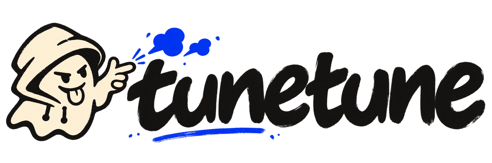

<p align="center">English · <a href="README_zh.md">简体中文</a></p>

<p align="center">
  
</p>

> Work with your Agent to train, test, and improve small models for your own tasks.

<p align="center">
  <a href="https://github.com/nanshine/tunetune/actions/workflows/ci.yml"></a>
  <a href="https://www.npmjs.com/package/dsh-tunetune"></a>
  <a href="LICENSE"></a>
</p>

## Quick start


Send this to your Agent:

```text
Install TuneTune following https://github.com/nanshine/tunetune/blob/main/INSTALL.md
```

Then, in the folder where you want to start a study, try a request like:

```text
Use TuneTune to train a small model that names Pokémon from silhouettes or screenshots in the anime’s “Who’s That Pokémon?” segment. Help me find public Pokémon image collections.
```

Already installed? Start with the request. Prefer to install it yourself? See [Installation](#installation).

<!-- Add a real demo video here once recorded, using the same request and showing actual elapsed time. -->

## How it works

Tell your Agent what you want the model to do. It looks into the task, compares approaches, and proposes a plan with estimated time, downloads, and costs for you to review.

It then prepares test examples, measures a simple starting model, and improves it through rounds of experiments. Follow the plans, experiments, and results in the workbench, and try your own inputs to see how well the model works for you. Your Agent asks for your judgment when reference answers need review or the budget or direction needs to change.


| Skill | Role |
|---|---|
| `tunetune-init` | Set up the study, understand the task, research approaches, and agree on a plan and budget. |
| `build-evaluation` | Prepare test examples and scoring, check that the tests are useful, and measure a starting model. |
| `run-experiments` | Try improvements in rounds, compare results, and verify that the final model runs locally. |
| `research-workspace` | Keep and display study records so your Agent can continue from earlier work. |

When the goal is met, the budget runs out, or no worthwhile next experiment remains, your Agent explains the results, limitations, and recommended next step.

## Installation

### Claude Code

```text
/plugin marketplace add nanshine/tunetune
/plugin install tunetune@tunetune
```

### Codex

```sh
codex plugin marketplace add nanshine/tunetune
codex plugin add tunetune@tunetune
```

### DeepSeek Harness

Install `dsh-tunetune` from **Plugins** to get the skills and a workbench beside your conversation.

For a CLI-managed profile:

```sh
dsh plugin --profile <profile> add dsh-tunetune
```

### Other Agents with skills support

Install the skills for your Agent, replacing `<application>` with its identifier, such as `cursor` or `opencode`:

```sh
npx skills add nanshine/tunetune --global --agent <application> -y
```

## Contributing

[Report an issue](https://github.com/nanshine/tunetune/issues), share a real study, or submit a pull request. For code changes, see the repository's [contribution guidelines](CONTRIBUTING.md).

## License

[Apache-2.0](LICENSE).
