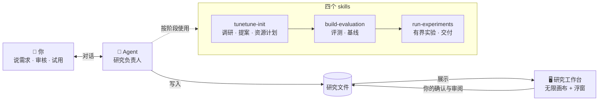

<div align="center">


# TuneTune

**说出你的需求，Agent 在你的电脑上帮你研究出一个能用的私有小模型。**

你提需求、做审核，Agent 当研究负责人 —— 从一句话到本地模型，每一步都有证据。

`本地运行` · `数据不出电脑` · `Codex / Claude Code / Cursor 等 Agent 通用`

</div>

---

## 一句话开始

把下面这句话交给能读写本地文件、运行命令的 Agent（Codex、Claude Code 等）：

> 用 TuneTune（https://github.com/nanshine/tunetune）帮我做一个能认出我家几只猫分别是谁的模型，照片在 `./photos` 里，就在当前文件夹开始。

换成你自己的需求就行。Agent 会安装 skills、初始化当前目录、打开研究工作台，然后开始调研。

**Agent：按 [INSTALL.md](INSTALL.md) 安装四个 skills，初始化当前目录，启动研究空间，再用 `tunetune-init` 延续原始需求。不要自行创建独立子研究目录。**

只需要 macOS / Linux 和 Python 3.10+。面板已随 skills 构建好，不用克隆源码，也不用 Node.js。

## 它长什么样

<!-- 占位：30 秒演示 GIF。流程：输入一句需求 → 提案窗口弹出 → 点确认 → 画布上长出几轮实验 → 拖入一张自己的照片看到结果。等待处用"⏩ 20 分钟后"字幕跳过。放到 docs/assets/demo.gif -->


<table>
<tr>
<td width="33%"><!-- 占位：提案窗口截图 docs/assets/proposal.png --><br><sub><b>研究提案</b>：方案、备选和资源上限，确认一次即可开始</sub></td>
<td width="33%"><!-- 占位：逐条审阅参考答案截图 docs/assets/review.png --><br><sub><b>你来定标准</b>：主观判断的答案由你逐条审阅</sub></td>
<td width="33%"><!-- 占位：验收窗口截图 docs/assets/acceptance.png --><br><sub><b>亲手试</b>：输入你自己的例子，对比各模型的真实输出</sub></td>
</tr>
</table>

## 为什么不一样

- **Agent 是研究负责人，你是审核人。** 它调查方法、准备资源、跑实验；你只在关键判断上拍板。
- **先评测，再下结论。** 先建立校准过的评测并测出基线，之后每一轮实验都和它比，不靠感觉。
- **你的数据、你的标准、你的模型。** 小模型在自己电脑上跑，同样的需求，不同的人会得到不同的结果。
- **诚实交付。** 只交付实际验证过的本地模型；达不到目标会直说原因，并给出下一步建议。

## 它怎样运作



`research-workspace` 把整个研究串起来：管理文件、恢复进度，并把工作分派到上面三个阶段。

1. **提案**：Agent 先问清用途，再查当下可用的模型和方法，给出推荐路线、备选和资源上限（下载多大、花不花钱、数据出不出电脑）。你确认一次。
2. **评测**：搭建能真正打分的评测，同时测出最便宜可信的基线。答案取决于你的主观判断时，冻结前请你审阅。
3. **实验**：在预算内一轮轮实验，每轮说明测什么、为什么、和谁比。
4. **交付**：选出实际验证过的本地模型。你可以在工作台里用自己的输入亲手试。

环境、下载、缓存都放在研究目录里，不想要了，删掉目录即可。

## 可以拿它做什么

> 帮我做一个认出我家几只猫分别是谁的模型，照片在 `./photos`。

> 帮我按我自己的习惯给支付宝账单分类，账单不要传到网上。

> 帮我做一个判断哪些消息需要马上回复的模型，标准按我的来。

> 帮我做一个能整理客户留言、分出问题类型的模型。

<!-- 占位：更多真实案例与成果截图 -->

<details>
<summary><b>其他安装方式</b></summary>

用 skills CLI 一次安装，所有目录可用，把 `--agent` 换成你的应用：

```sh
npx skills add nanshine/tunetune --global --agent codex
npx skills add nanshine/tunetune --global --agent claude-code
npx skills add nanshine/tunetune --global --agent cursor
npx skills add nanshine/tunetune --global --agent opencode
npx skills add nanshine/tunetune --global --agent trae      # Trae 国内版用 trae-cn
npx skills add nanshine/tunetune --global --agent qoder     # Qoder 国内版用 qoder-cn
```

`--agent '*'` 会装到所有支持的应用；之后用 `npx skills update` 更新。没有 Node.js 时，把 `plugins/tunetune/skills/` 下的四个文件夹复制到应用的用户 skills 目录：

| 应用 | 用户 skills 目录 |
|---|---|
| Claude Code | `~/.claude/skills/` |
| Codex | `~/.agents/skills/` |
| Cursor | `~/.cursor/skills/` |
| OpenCode | `~/.config/opencode/skills/` |
| Trae / Trae CN | `~/.trae/skills/` / `~/.trae-cn/skills/` |
| Qoder / Qoder CN | `~/.qoder/skills/` / `~/.qoder-cn/skills/` |
| 其他应用 | 查阅其 skills 文档；不少应用也读取 `~/.agents/skills/` |

除 Claude Code 和 Codex 外，其他应用尚未逐一实测。

插件方式：

```text
# Claude Code
/plugin marketplace add nanshine/tunetune
/plugin install tunetune@tunetune
```

```sh
# Codex
codex plugin marketplace add nanshine/tunetune
codex plugin add tunetune@tunetune
```

装好后在想做研究的目录里说出需求即可。初始化只补齐缺失的文件，并把研究工具固定在 `.workspace/app/`，之后更新 skills 不会改动已有研究所用的工具；用其他版本工具创建的研究会被明确拒绝，不会自动迁移或覆盖。

</details>

<details>
<summary><b>仓库结构</b></summary>

| 路径 | 内容 |
|---|---|
| `plugins/tunetune/skills/` | 四个 skills：研究工作流、技术参考、研究工具、模板和构建好的面板，这就是全部分发内容 |
| `plugins/tunetune/` | 插件根目录，只含 skills 和插件清单 |
| `.claude-plugin/`、`.agents/plugins/` | 指向插件根目录的插件市场 |
| `workspace/` | 面板源码（React / TypeScript） |
| `scripts/` | 清单构建和本地演示工具 |
| `tests/` | 集成与安全测试 |
| `docs/` | [设计原则](docs/principles.md)等文档 |

</details>

<details>
<summary><b>开发与本地演示</b></summary>

需要 Node.js 22.12+ 和 Python 3.10+：

```sh
npm --prefix workspace ci
npm --prefix workspace run build
npm --prefix workspace test
python3 -B -m unittest discover -s tests -v
python3 scripts/build-skills.py
```

面板构建输出到 `plugins/tunetune/skills/research-workspace/assets/panel/`，并且需要提交，因为 `npx skills`、插件和克隆都直接取仓库里的 skills。修改分发的脚本、模板或面板后，重新运行 `build-skills.py`。

用合成数据看一个完整的研究状态：

```sh
python3 plugins/tunetune/skills/research-workspace/scripts/init.py --project /absolute/my-research
python3 scripts/create-demo.py --project /absolute/my-research
python3 /absolute/my-research/.workspace/app/workspace.py --project /absolute/my-research --port 0 --open
```

演示证明流程能跑通，不代表真实业务的效果。

</details>

---

<div align="center">
<sub>设计理念见 <a href="docs/principles.md">docs/principles.md</a> · <a href="LICENSE">Apache-2.0</a></sub>
</div>
