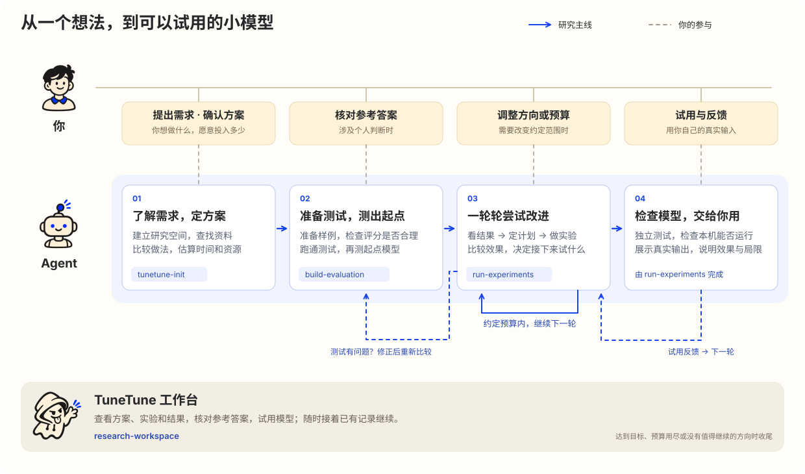

<p align="center"><a href="README.md">English</a> · 简体中文</p>

<p align="center">
  
</p>

> 和 Agent 一起，为自己的具体问题训练、测试和改进小模型。

<p align="center">
  <a href="https://github.com/nanshine/tunetune/actions/workflows/ci.yml"></a>
  <a href="https://www.npmjs.com/package/dsh-tunetune"></a>
  <a href="LICENSE"></a>
</p>

## 快速开始


把这句话发给你的 Agent：

```text
按照 https://github.com/nanshine/tunetune/blob/main/INSTALL.md 安装 TuneTune。
```

然后在想开展研究的文件夹里，试着提出一个需求：

```text
用 TuneTune 训练一个小模型，根据宝可梦动画“猜猜我是谁”中的剪影或截图，猜出宝可梦的中文名字。请帮我寻找公开的宝可梦图集。
```

已经安装？直接说需求即可。也可以按下面的[安装说明](#安装)自行安装。

<!-- 录好真实演示后在这里加入视频，使用同一个需求，并标出实际耗时。 -->

## 它是怎么工作的

告诉 Agent 你想让模型做什么，它会先了解需求、查找资料，整理出做法和预计需要的时间、下载量与费用，与你确认后开始。

接下来，Agent 会准备测试样例，先跑一个简单模型作为比较起点，再一轮轮尝试改进。你可以在工作台查看方案、实验和结果，也可以用自己的输入试一试，看看模型是否真的好用；需要你判断参考答案，或调整预算和方向时，Agent 会找你确认。



| Skill | 分工 |
|---|---|
| `tunetune-init` | 建立研究空间，了解需求、查找资料，与你确定做法和预算。 |
| `build-evaluation` | 准备测试样例和评分方法，检查测试是否合理，测出起点模型的表现。 |
| `run-experiments` | 一轮轮尝试改进，比较结果，检查最后交给你的模型能否在本机使用。 |
| `research-workspace` | 保存和展示研究记录，让 Agent 能接着已有工作继续。 |

达到目标、预算用尽，或没有值得继续尝试的方向时，Agent 会说明结果、局限和下一步建议。

## 安装

### Claude Code

```text
/plugin marketplace add nanshine/tunetune
/plugin install tunetune@tunetune
```

### Codex

```sh
codex plugin marketplace add nanshine/tunetune
codex plugin add tunetune@tunetune
```

### DeepSeek Harness

在应用的**插件**页面安装 `dsh-tunetune`，即可使用 skills 和对话旁的工作台。

使用命令行管理 profile 时：

```sh
dsh plugin --profile <profile> add dsh-tunetune
```

### 其他支持 skills 的 Agent

安装到你的 Agent，将 `<application>` 替换为应用标识，例如 `cursor` 或 `opencode`：

```sh
npx skills add nanshine/tunetune --global --agent <application> -y
```

## 参与贡献

欢迎[反馈问题](https://github.com/nanshine/tunetune/issues)、分享真实研究案例或提交 PR；修改代码时，请参考仓库的[贡献指南](CONTRIBUTING.md)。

## 许可证

[Apache-2.0](LICENSE)。
